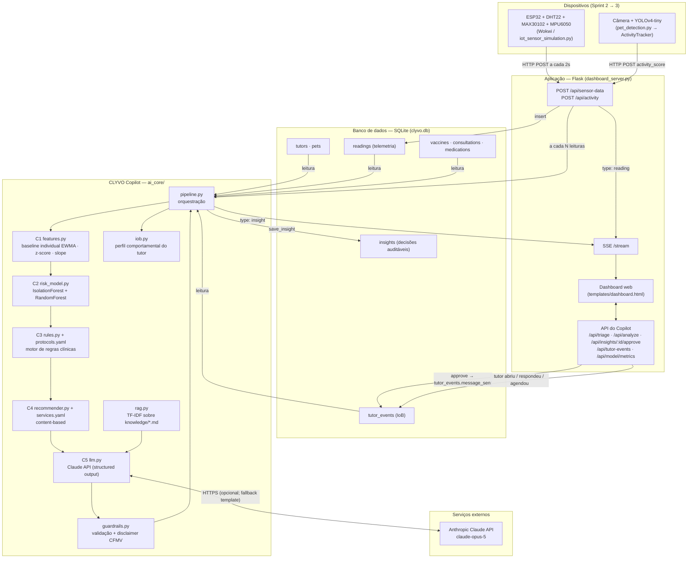
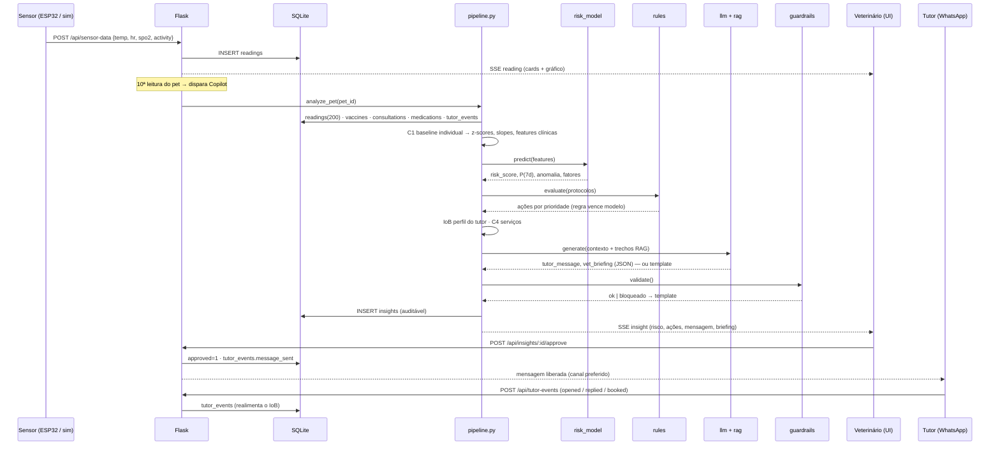

# Arquitetura — CLYVO VET + CLYVO Copilot

> Diagrama arquitetural mostrando a comunicação entre aplicação, banco de dados, APIs e componentes de IA (Sprint 3).
> O GitHub renderiza o Mermaid abaixo nativamente. Uma exportação em PNG está em `docs/arquitetura.png`.

## Visão geral

## Fluxo de dados (sequência de uma análise)

## Componentes

| Camada | Componente | Tecnologia | Responsabilidade |
|---|---|---|---|
| Dispositivo | `wokwi/` + `iot_sensor_simulation.py` | ESP32, DHT22, MAX30102, MPU6050 (simulados) | Telemetria a cada 2 s; alertas por limite absoluto |
| Dispositivo | `pet_detection.py` | OpenCV + YOLOv4-tiny | Detecta o pet; **deslocamento do bbox → `activity_score`** |
| Aplicação | `dashboard_server.py` | Flask + SSE | Ingestão, persistência, gatilho do Copilot, API, human-in-the-loop |
| Aplicação | `templates/dashboard.html` | HTML + Chart.js | Telemetria ao vivo, painel do Copilot, fila de triagem, IoB |
| Dados | `ai_core/db.py` | SQLite (WAL) | 8 tabelas — ver `docs/modelo-de-dados.md` |
| IA C1 | `ai_core/features.py` | Python puro | Baseline individual (EWMA), z-score, slope, features clínicas |
| IA C2 | `ai_core/risk_model.py` | scikit-learn | IsolationForest (anomalia) + RandomForest (P atenção 7 d), explicabilidade |
| IA C3 | `ai_core/rules.py` | YAML declarativo | Protocolo vacinal, vermifugação, check-up, adesão, retorno, limites |
| IA C4 | `ai_core/recommender.py` | cosseno sobre tags | Serviços da clínica compatíveis com contexto do pet e do tutor |
| IoB | `ai_core/iob.py` | Python puro | Engajamento, canal, horário e tom a partir dos eventos do tutor |
| IA C5 | `ai_core/llm.py` + `rag.py` | Anthropic SDK + TF-IDF | Redige mensagem e briefing ancorados no contexto; fallback template |
| Segurança | `ai_core/guardrails.py` | regex + regras | Bloqueia diagnóstico/posologia; exige CTA; disclaimer CFMV |
| Orquestração | `ai_core/pipeline.py` | Python | Executa C1→C5, persiste o insight, publica via SSE |

## Endpoints

| Método | Rota | Uso |
|---|---|---|
| POST | `/api/sensor-data` | Telemetria do wearable (Sprint 2, agora persistida) |
| POST | `/api/activity` | Índice de atividade vindo da visão computacional |
| GET | `/api/history?pet_id=` | Últimas leituras do pet |
| GET | `/api/pets` · `/api/pets/:id` · `/api/pets/:id/baseline` · `/api/pets/lookup?name=` | Cadastro, prontuário e baseline individual |
| GET | `/api/triage` | Fila de triagem — último insight por pet, ordenado por risco |
| GET | `/api/insights/latest?pet_id=` · `/api/insights/:id` | Insight completo |
| POST | `/api/analyze/:pet_id` | Roda o Copilot sob demanda (`{"llm_mode": "offline"}` opcional) |
| POST | `/api/insights/:id/approve` | Veterinário aprova → mensagem liberada + evento IoB |
| POST | `/api/tutor-events` | Simula reação do tutor (IoB) |
| GET | `/api/model/metrics` · POST `/api/model/train` | Métricas / retreino do modelo |
| GET | `/api/health` | Estado do sistema (DB, modelo, LLM, RAG) |
| GET | `/stream` | SSE: `reading`, `activity`, `insight`, `status` |

## Decisões de arquitetura

- **SQLite, não Postgres.** O entregável precisa rodar a partir do .zip sem infraestrutura. WAL habilitado para leitura concorrente com o Flask *threaded*.
- **HTTP + SSE, não MQTT.** Mantém o protocolo já validado no Sprint 2; a arquitetura de ingestão não muda, só ganha persistência.
- **O Copilot roda no servidor, não no dispositivo.** O ESP32 continua "burro" (coleta e alerta absoluto); toda a inteligência é centralizada onde há histórico e prontuário.
- **LLM por último e opcional.** A decisão (risco, ações, serviços) existe e é persistida mesmo sem LLM. O LLM só muda a *forma* da comunicação.
- **Human-in-the-loop obrigatório.** Nenhuma mensagem com conteúdo clínico é enviada ao tutor sem aprovação do veterinário (`approved=1`).

## Integrações futuras (roadmap — resposta ao feedback do Sprint 2)

| Integração | O que muda | Onde encaixa |
|---|---|---|
| WhatsApp Business API | `approve` passa a disparar a mensagem real; webhooks alimentam `tutor_events` | `dashboard_server.py` → serviço de mensageria |
| Agenda da clínica (Google Calendar / sistema próprio) | CTA "agendar" vira link com slot real; `appointment_booked` automático | `recommender` + `approve` |
| Prontuário / ERP veterinário | `vaccines`, `consultations`, `medications` sincronizados em vez de seed | `ai_core/db.py` (camada de sync) |
| Farmácia / pet shop | Ação de adesão gera reposição automática do medicamento | `services.yaml` + novo endpoint |
| Planos de saúde pet | Score de risco preventivo como insumo de elegibilidade/precificação | `insights` (export) |
| Telemedicina | Teleconsulta recomendada abre sala de vídeo em 1 clique | `services.yaml` → link |
| Hardware real | ESP32 físico com MPU6050; MQTT quando houver múltiplos dispositivos | `wokwi/` → firmware |
