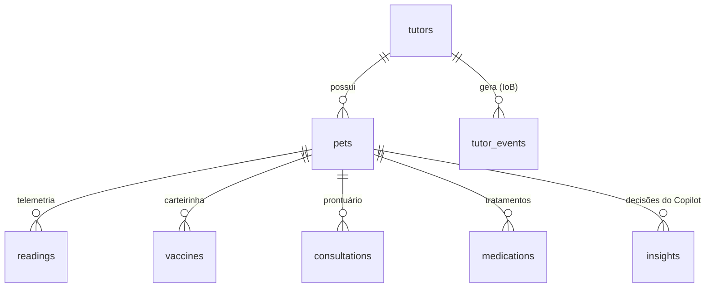

# Modelo de dados — origem, estrutura e utilização

Banco: SQLite (`clyvo.db`, WAL). Schema em `ai_core/db.py`. Seed sintético com seed fixa em `data/generate_dataset.py`.

## Entidades

| Tabela | Campos principais | Origem no produto | Origem nesta entrega | Uso na IA |
|---|---|---|---|---|
| `tutors` | nome, telefone, `preferred_channel`, `preferred_hour` | Cadastro no app | seed | IoB (fallback de canal/horário), personalização |
| `pets` | espécie, raça, sexo, castrado, `birth_date`, `weight_kg` | Cadastro no app | seed | Features clínicas; protocolo por espécie/idade |
| `readings` | `ts`, `temperature_c`, `humidity_pct`, `heart_rate_bpm`, `spo2_pct`, `activity_score`, `source` | **ESP32 (Sprint 2)** + **YOLO/ActivityTracker (Sprint 3)** | seed (60/pet) + simulação ao vivo | **Baseline individual, z-scores, slopes; IsolationForest** |
| `vaccines` | vacina, `applied_at`, `next_due`, lote | Prontuário / carteirinha (OCR futuro) | seed | Regra R1 (atraso, vencimento próximo); feature `vaccine_overdue_days` |
| `consultations` | data, motivo, diagnóstico, procedimento, `return_due`, `returned` | Prontuário da clínica | seed | Regras R3 (check-up) e R5 (retorno); feature `days_since_last_consult` |
| `medications` | nome, início, fim, frequência, `doses_expected`, `doses_confirmed` | Prescrição + confirmação do tutor no app | seed | Regras R2 (vermífugo) e R4 (adesão); feature `med_adherence_pct` |
| `tutor_events` | `event_type`, canal, `ts` | Logs do app / webhooks do WhatsApp | seed + botões IoB no dashboard | **IoB**: engajamento, canal/horário efetivos, faltas, confirmação de doses |
| `insights` | risco, nível, anomalia, P(7d), fatores, ações, serviços, mensagem, briefing, `llm_mode`, guardrail, features, `approved`, `sent_at` | — (gerado pelo Copilot) | pipeline | Auditoria; fila de triagem; human-in-the-loop |

`event_type` ∈ `message_sent · opened · replied · appointment_booked · no_show · med_confirmed · med_missed`.

## Base de conhecimento (RAG)

`knowledge/*.md` — Markdown versionado, dividido por títulos `##` em trechos indexados por TF-IDF:

| Arquivo | Conteúdo |
|---|---|
| `protocolo_vacinal.md` | Protocolos cão/gato, vermifugação, conduta em atraso, política de lembretes |
| `sinais_de_alerta.md` | Interpretação de temperatura, FC, SpO₂ e atividade; leitura por baseline individual |
| `servicos_da_clinica.md` | Catálogo, preços, agendamento, cancelamento |
| `comunicacao_com_tutor.md` | Tom, estrutura, o que nunca dizer, personalização por engajamento, LGPD |

## Vetor de features do modelo (`ai_core/features.py::FEATURE_ORDER`)

| Feature | Tipo | Cálculo | Faixa típica |
|---|---|---|---|
| `temp_z`, `hr_z`, `spo2_z`, `act_z` | telemetria | (média das 10 leituras recentes − baseline EWMA) / σ do baseline | −4 … +4 |
| `temp_slope`, `hr_slope`, `spo2_slope`, `act_slope` | telemetria | variação prevista pela reta de mínimos quadrados na janela, em σ | −3 … +3 |
| `age_years` | clínico | (hoje − nascimento) / 365,25 | 0,2 … 15 |
| `weight_kg` | clínico | cadastro | 2 … 40 |
| `is_cat` | clínico | 1 se gato | {0, 1} |
| `days_since_last_consult` | clínico | hoje − última consulta (730 se nunca) | 0 … 730 |
| `vaccine_overdue_days` | clínico | maior atraso entre vacinas vencidas | 0 … 180 |
| `med_adherence_pct` | clínico | média de `doses_confirmed / doses_expected` | 30 … 100 |

Rótulo do dataset de treino: `needs_attention_7d` ∈ {0, 1}. Coluna auxiliar `pattern` (normal, febre, cardio, respiratório, letargia, misto) para análise — **não** entra no modelo.

## Dataset de treino (`data/training_dataset.csv`)

- 2.000 episódios, ~34 % positivos, seed 43.
- Modelo gerador: `logit = −1,7 + 0,9·[idade ≥ 8] + 0,5·[idade < 1] + 0,7·[atraso vacinal > 30 d] + 0,8·[adesão < 70 %] + 0,4·[> 400 d sem consulta]`; `sick ~ Bernoulli(σ(logit))`.
- Se `sick`: padrão sorteado define quais z/slopes se deslocam (ex.: febre → `temp_z ~ N(2,2; 0,7)`, `temp_slope ~ N(1,2; 0,5)`, `act_z ~ N(−1,2; 0,8)`).
- Se saudável: z ~ N(0; 0,75), slopes ~ N(0; 0,55); 10 % com um pico espúrio isolado (ruído realista).
- 7 % de inversão de rótulo.

## Privacidade e retenção

Ver `docs/lgpd-e-guardrails.md`. Em produção: dados pessoais do tutor minimizados (nome, canal, telefone), finalidade única (cuidado do pet), consentimento no cadastro, exclusão sob solicitação, telemetria bruta com retenção de 12 meses e agregados por mais tempo.
